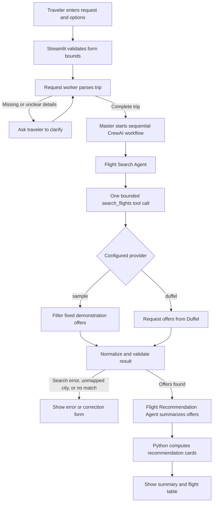

# AI Flight Finder

A local, educational flight-search demo. Ask for a trip in plain language, review the interpreted details, search sample or Duffel flight offers, and compare the results. The interface is built with Streamlit; CrewAI coordinates local Ollama-powered agents for the search and traveler-facing summary.

> **Scope:** This application searches and compares offers only. It does not reserve seats, book flights, collect payment, or guarantee that a displayed fare remains available.

## What the app does

1. Accepts a natural-language trip request, such as “Find flights from San Francisco to New York on September 21, 2027.”
2. Extracts and validates the origin, destination, and departure date.
3. Asks for missing or correctable details instead of silently inventing them.
4. Searches the provider selected in configuration: built-in sample data or Duffel.
5. Shows the interpreted trip, a short summary, cheapest/fastest/best-choice cards, and a table of returned flight options.

### Search options

| Option | Sample provider | Duffel provider |
| --- | --- | --- |
| One-way | Yes | Yes |
| Return trip | No | Yes |
| Adult travelers | Exactly 1 | 1–9 |
| Cabin | Economy only | Economy, premium economy, business, or first |
| Data | Fixed demo offers | Offers returned by Duffel |
| Credentials | None | Duffel API token |

Sample mode contains four illustrative offers for **San Francisco (SFO) to New York (NYC) on 2027-09-21**, for one adult in economy, one-way. It does not generate data for other routes or dates. These are sample values, not live fares.

Duffel mode maps a finite list of common city names to IATA city/airport codes and also accepts a 3-letter IATA code (for example `SFO` or `NYC`). This is not a worldwide airport directory. The Duffel integration requests at most 50 offers, normalizes usable results to the app’s common format, and uses a 30-second HTTP timeout.

## How to use it

1. Enter a request using the form `from <origin> to <destination> on <date>`.
2. Choose the number of adults and cabin. Enable **Round trip** and enter a return date in `YYYY-MM-DD` format when needed.
3. Select **Search flights**.
4. Review the trip the app understood and the offer summary/table.
5. If details are missing, a city cannot be mapped, or no offers match, fill in the requested correction fields and choose **Continue search**.

The request box accepts up to 500 characters, the return-date field up to 10. Departure dates can be written as `YYYY-MM-DD`, `Month DD, YYYY`, or `Mon DD, YYYY` (for example, `September 21, 2027`). Return dates must be `YYYY-MM-DD` and later than departure. Invalid or unclear details are not treated as confirmed trip data.

### Clarification and error behavior

- **Missing origin, destination, or date:** the app displays a follow-up form for those fields.
- **Unmapped Duffel city:** it asks for a supported city or a 3-letter IATA code.
- **No matching offers:** it asks you to change the route or travel date.
- **Unclear request:** it asks you to rephrase it.
- **Provider, token, connection, or AI-crew failure:** the app reports the failure; it does not pretend the search succeeded or ask you to change trip details as if the route were the problem.

## How the agents and search flow work

The LLM does not have authority to choose the provider or modify the validated itinerary. Python validates the user request and configuration; the tool checks the CrewAI agent’s arguments against that validated request before it searches.



The diagram shows the happy path and where the app branches for clarification or search issues. The request-understanding worker uses a deterministic parser first; for ambiguous wording, it can ask a local Ollama model to extract the same three fields without inventing missing details. The master validates the parsed request before starting the sequential CrewAI crew.

### Agent responsibilities and guardrails

1. **Flight Search Agent** receives the validated itinerary and can use only the `search_flights` tool. The tool checks the requested values match the validated origin, destination, dates, passenger count, and cabin; it permits one provider search per request.
2. **Flight Recommendation Agent** receives the search output and writes a concise explanation based only on returned data.
3. **Python summary logic** calculates the cheapest and fastest offers from provider results. The current “Best overall” selection is the cheapest offer; it is not an independent LLM ranking.

The CrewAI workflow is sequential, with bounded agent iterations, execution time, and retries. The search provider is selected with `FLIGHT_SEARCH_PROVIDER`, not by an agent. If the crew fails after a successful search, the application can still create a deterministic summary from the returned offers.

## Search providers

### Sample mode (default)

Sample mode requires no flight-provider credentials and is useful for exploring the UI and running tests. It only returns its fixed San Francisco-to-New-York dataset for the one route/date and options listed above. Choosing return trip, multiple adults, or another cabin in sample mode returns an explanatory limitation message.

### Duffel mode

Duffel mode sends an offer request to Duffel’s API. It supports one-way and return trips, 1–9 adults, and economy, premium economy, business, or first class. To enable it:

1. Create a Duffel test-mode API token in your Duffel account.
2. Copy `.env.example` to `.env`.
3. Set `FLIGHT_SEARCH_PROVIDER=duffel` and replace the placeholder value for `DUFFEL_ACCESS_TOKEN`.
4. Restart Streamlit and search again.

Test-mode offers are for integration testing and do not guarantee real-world prices or availability. Live fares require appropriate provider access and may change. The finite city mapping is in `src/duffel_client.py`.

## Architecture and project layout

```text
app.py                              Streamlit form, session state, and results UI
src/
	agents/
		master_agent.py                 Request validation and workflow coordination
		request_worker.py                Request extraction and clarification helpers
		crewai_flight_crew.py            Sequential search and recommendation agents
		flight_search_tool.py            Validated, one-call CrewAI search tool
		search_worker.py                 Provider search worker
		recommendation_worker.py         Summary worker
	flight_parser.py                  Deterministic natural-language parser
	llm_client.py                     Local Ollama extraction fallback
	flight_search.py                  Provider selection and sample results
	duffel_client.py                  Duffel request and offer normalization
	flight_summary.py                 Cheapest/fastest selection and summary cards
	flight_constants.py               Shared result messages
tests/                              Pytest unit and integration-style tests
.env.example                        Environment-variable template
requirements.txt                    Python dependencies
```

The UI invokes `FlightFinderMasterAgent`. For a valid trip, it delegates to `CrewAIFlightCrew`, which passes exact trip data to the search agent and then gives the search result to the recommendation agent. The search tool routes through `src/flight_search.py`; that module chooses sample or Duffel from configuration. Duffel offers are normalized before they reach the UI so the presentation and summary code can work with a consistent result shape.

## Setup and run locally

### Prerequisites

- Python with support for the pinned CrewAI release (the project was tested with Python 3.12).
- Ollama installed and running locally, with a tool-capable model available. The default CrewAI model is `qwen2.5:7b`.
- A Duffel token only if you choose Duffel mode.

Install Ollama using its official instructions, start its local service, and download the default model if it is not already available. Then, from the project directory:

```bash
python -m venv .venv
source .venv/bin/activate
pip install -r requirements.txt
streamlit run app.py
```

Open the local URL printed by Streamlit. For the default sample provider, you do not need a Duffel token, but the CrewAI search/recommendation workflow still needs a working local Ollama model.

### Configuration

Copy `.env.example` to `.env` and adjust values as needed:

| Variable | Purpose | Default |
| --- | --- | --- |
| `FLIGHT_SEARCH_PROVIDER` | Select `sample` or `duffel` | `sample` |
| `DUFFEL_ACCESS_TOKEN` | Duffel API bearer token; required only for Duffel | Placeholder |
| `CREWAI_MODEL` | CrewAI model identifier | `ollama/qwen2.5:7b` |
| `OLLAMA_BASE_URL` | Ollama base URL used by CrewAI | `http://localhost:11434` |
| `CREWAI_TRACING_ENABLED` | CrewAI tracing switch | `false` |

**Model configuration note:** `CREWAI_MODEL` and `OLLAMA_BASE_URL` configure the CrewAI agents. The separate ambiguity-extraction fallback in `src/llm_client.py` currently uses `qwen2.5:7b` at `http://localhost:11434` directly; changing the CrewAI variables does not change that fallback.

## Tests

Run the automated test suite from the project root:

```bash
pytest -q
```

Provider and HTTP behavior is tested with mocked responses, so the test suite does not require a Duffel token or live Duffel network access. Tests cover request parsing and clarification, provider selection, offer normalization, recommendation logic, and CrewAI tool constraints.

## Troubleshooting

| Symptom | Checks |
| --- | --- |
| CrewAI cannot connect or agents fail | Confirm Ollama is running locally, `CREWAI_MODEL` is installed and supports tool calling, and `OLLAMA_BASE_URL` is correct. |
| Ambiguous request does not parse | Use the explicit `from … to … on …` format and a supported date format. Confirm the default `qwen2.5:7b` model is available for the ambiguity fallback. |
| Duffel says the token is not configured | Check that `.env` exists, contains a real `DUFFEL_ACCESS_TOKEN`, and that `FLIGHT_SEARCH_PROVIDER=duffel`; restart Streamlit after edits. |
| Duffel cannot map a location | Try a city name in the finite mapping or enter a 3-letter IATA code. |
| No sample flights appear | Use San Francisco to New York on September 21, 2027, one adult, economy, one-way; other sample searches are not included. |
| Duffel request fails | Check network access, token validity, date/options, and Duffel test-mode availability. The integration uses a 30-second request timeout. |

## Security and data handling

- Keep `.env` local. It is ignored by Git; never commit or paste API tokens into source code, chat, screenshots, or logs.
- A Duffel search sends itinerary and passenger-count/cabin details to Duffel. Do not enter payment details or sensitive personal information; booking and payment are not implemented.
- Ollama is configured for a local endpoint by default. Do not assume it is local if you change `OLLAMA_BASE_URL` to a remote host.
- The search tool restricts the agent to one search using the validated trip. The LLM cannot choose a different provider, book, or pay.

## Learning goals

- Parse natural-language input into structured trip details.
- Request missing information and recover from unmapped locations or no-match searches.
- Keep provider selection and validation in deterministic Python code.
- Use CrewAI agents with a narrowly scoped tool.
- Normalize provider offers and calculate comparable cheapest/fastest options.
- Test provider behavior without live credentials or network dependencies.

## Duffel references

- [Duffel Offer Requests](https://duffel.com/docs/api/offer-requests)
- [Duffel key concepts](https://duffel.com/docs/api/overview/key-concepts)
